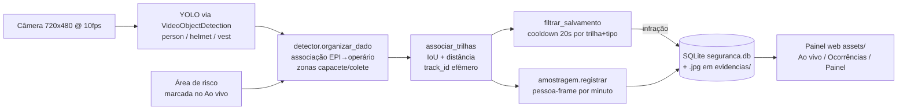

# Arquitetura — Painel de EPIs (Arduino UNO Q)

## Visão geral

Sistema de detecção de EPIs (capacete + colete) e invasão de área de risco,
rodando no Arduino UNO Q com YOLO, persistência em SQLite no pendrive e
painel web servido pela própria placa.

## Fluxo de dados

## Módulos Python (`python/`)

| Módulo | Papel |
|---|---|
| `config.py` | Fonte única da verdade: caminhos, cooldowns, limiares, zonas EPI, câmera, amostragem, segurança, meta 95%. Sem dependências (evita import circular). |
| `detector.py` | Pipeline YOLO→operários→trilhas→salvamento→amostragem. Mantém aliases (`TEMPO_ESPERA`, `ZONA_*`, …) por compatibilidade. |
| `banco.py` | SQLite (ocorrências + amostras), migração idempotente, dashboard, revisão sem apagar. Aliases `CAMINHO_BANCO`/`PASTA_FOTOS` preservados (preview faz monkey-patch). |
| `amostragem.py` | Denominador pessoa-frame em baldes de 1 min, descarga a cada 30 s. |
| `seguranca.py` | Login PBKDF2, cookie HttpOnly, rate-limit. Senha só via `TCC_SENHA_HASH`. |
| `servidor.py` | WebUI + rotas HTTP. Importado por `detector`/`banco` — por isso `detector` é importado primeiro (ver `main.py`, `tests/conftest.py`). |
| `main.py` | `import detector, servidor, banco` + `App.run()` (ordem importa!). |

## Frontend (`assets/`)

`index.html` + ES modules em `js/` (`app`, `nucleo`, `tela_*`, `grafico` SVG puro,
`util`, `api`, `conexao_ui` = `new WebUI()`). Libs: `socket.io.min.js`,
`arduino.js`. O `chart.umd.min.js` foi removido (órfão após migração p/ SVG).
